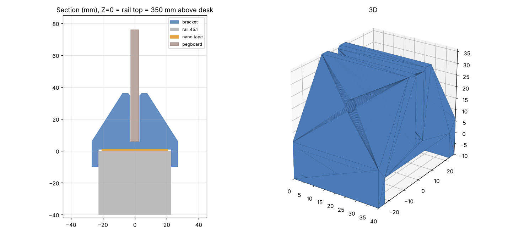

# 洞洞板支架（隔断横梁 + 纳米胶）

## 实测数据
- 横梁宽 **45.1 mm**（卡尺）
- 横梁顶面距桌面 **350 mm**
- 横梁可用长度约 **600 mm**（T 型接头到端盖）

## 结构
倒 U 形“马鞍”扣在横梁顶面，中间是竖直插槽，洞洞板竖着插在横梁上方。
- 底面留 1 mm 纳米胶间隙，胶贴在横梁顶面，接触面约 45 × 40 mm/个
- 两侧下包 10 mm 裙边：只负责定位、抗侧推，主要受力靠纳米胶
- 插槽深 30 mm，两侧斜撑，入口带倒角
- 可选 M4 横向螺栓孔，穿过洞洞板的孔把板锁死

## 文件
| 文件 | 说明 |
|---|---|
| `pegboard_bracket.scad` | OpenSCAD 参数化源文件（推荐在这里改尺寸） |
| `pegboard_bracket.stl` | 默认参数导出（洞洞板厚 5 mm） |
| `build.py` | 不装 OpenSCAD 也能出 STL：`python3 build.py board_t=4.5 len=50` |

## 先确认的参数
- `board_t`：**洞洞板厚度**，量实物再改（默认 5 mm，插槽 = 厚度 + 0.4）
- `lip_h`：横梁侧面如果有缝/台阶，裙边别盖过去，可以改短
- `board_off`：洞洞板想偏向某一侧桌子时用

## 打印建议
- 截面平放（40 mm 长度方向朝上），**无需支撑**
- PETG / ABS 优于 PLA（纳米胶 + 长期受力，PLA 易蠕变）
- 4 层壁、30%+ 填充
- 600 mm 横梁用 **3 个**（两端 + 中间）；板宽 ≤ 400 mm 用 2 个

## 安装
1. 横梁顶面用酒精擦干净
2. 纳米胶裁成约 44 × 38 mm，贴在支架底面
3. 扣上横梁按压 30 秒，**静置 24 小时**再插板挂东西
4. 洞洞板顶部离桌面高度 ≈ 350 + 6 + (板高 − 30) mm
